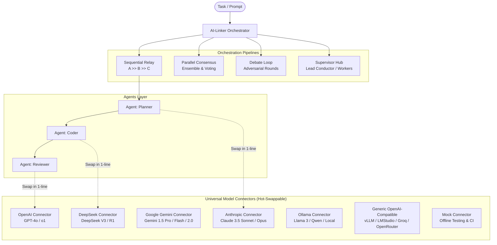

<div align="center">

# ⚡ AI-Linker

### Universal Multi-Agent Orchestrator & Pluggable Model Connector Hub
**Connect, coordinate, and hot-swap ANY AI model in 1 line of code — with Zero Vendor Lock-in.**

[](https://python.org)
[](https://opensource.org/licenses/MIT)
[]()
[]()

[English](README.md) • [Tiếng Việt](#-hướng-dẫn-tiếng-việt)

</div>

---

## 💡 Why AI-Linker?

Most agent frameworks either **lock you into a single ecosystem** or require writing massive adapter glue code every time a new frontier model drops. 

**AI-Linker** solves this by separating **Agent Personas & Workflows** from the **Underlying AI Models**:
- 🔄 **Hot-Swap Any Model in 1 Line:** Change from Claude 3.5 to DeepSeek R1 or local Ollama with `agent.set_connector("deepseek:deepseek-r1")`.
- 🔗 **Pythonic Chaining (`>>`):** Connect multi-agent relays with simple operators: `planner >> coder >> reviewer`.
- 🛡️ **Zero-Crash Fallback Chains:** Automatically route to a backup provider if your primary model hits rate limits or quota exhaustion.
- 🚀 **4 Built-in Orchestration Patterns:** Sequential Relay, Parallel Ensemble, Adversarial Debate, and Supervisor/Worker Hub.
- 🌐 **Zero SDK Bloat:** Direct lightweight HTTP engine powered by `httpx` — works with OpenAI, Anthropic, Gemini, DeepSeek, Ollama, Groq, and vLLM out of the box.

---

## 🏛️ Architecture Overview



---

## ⚡ Quickstart in 30 Seconds

### 1. Installation

```bash
git clone https://github.com/DiepTuHuy/AI-linker.git
cd AI-linker
pip install -e .
```

### 2. Configure API Keys (Optional for offline mock)

Copy `.env.example` to `.env`:
```bash
cp .env.example .env
```
Fill in the keys for the providers you want to use (`OPENAI_API_KEY`, `ANTHROPIC_API_KEY`, `GEMINI_API_KEY`, `DEEPSEEK_API_KEY`, etc.).

---

### 3. Quickstart: Hot-Swap Any Model in 1 Line

```python
from ai_linker import Agent

# Start with an Anthropic Claude agent
agent = Agent(name="Assistant", role="Consultant", connector="claude:claude-3-5-sonnet")
print(agent.chat_sync("Explain microservices in 1 sentence."))

# Hot-swap to DeepSeek R1 in ONE LINE:
agent.set_connector("deepseek:deepseek-r1")
print(agent.chat_sync("Now provide the trade-offs."))

# Hot-swap to a free local Ollama model:
agent.set_connector("ollama:llama3")
print(agent.chat_sync("Summarize in bullet points."))
```

---

## 🧩 4 Core Multi-Agent Patterns

### Pattern 1: Sequential Relay (`agent1 >> agent2 >> agent3`)
Pass output from one specialized agent directly to the next:

```python
from ai_linker import Agent

planner = Agent("Astra", "Software Architect", connector="claude:claude-3-5-sonnet")
coder = Agent("Sol", "Senior Python Engineer", connector="deepseek:deepseek-chat")
reviewer = Agent("Sentinel", "Security Lead", connector="openai:gpt-4o")

# Chain with the >> operator
dev_team = planner >> coder >> reviewer

result = dev_team.run_sync("Build a thread-safe LRU cache with TTL in Python.")
print(result.final_output)
```

---

### Pattern 2: Parallel Ensemble & Voting
Send the same prompt to multiple frontier models simultaneously and have a Judge evaluate consensus:

```python
from ai_linker import Agent
from ai_linker.pipelines import ParallelConsensus

ag_claude = Agent("ClaudeExpert", "Architecture Specialist", connector="claude:claude-3-5-sonnet")
ag_gpt = Agent("GPTExpert", "Scale Specialist", connector="openai:gpt-4o")
ag_deepseek = Agent("DeepSeekExpert", "Algorithm Specialist", connector="deepseek:deepseek-chat")
judge = Agent("LeadArchitect", "Chief Judge", connector="claude:claude-3-opus")

consensus = ParallelConsensus([ag_claude, ag_gpt, ag_deepseek], judge=judge)
result = consensus.run_sync("PostgreSQL vs ClickHouse for 50M daily event analytics?")
print(result.final_output)
```

---

### Pattern 3: Multi-AI Adversarial Debate Loop
Have 2 AI models argue across $N$ rounds, refining their arguments until a Judge delivers the verdict:

```python
from ai_linker import Agent
from ai_linker.pipelines import DebateLoop

debater_a = Agent("ProMonolith", "Senior Engineer", connector="claude:claude-3-5-sonnet")
debater_b = Agent("ProMicroservices", "Cloud Architect", connector="deepseek:deepseek-r1")
judge = Agent("Judge", "VP of Engineering", connector="openai:gpt-4o")

arena = DebateLoop(debaters=[debater_a, debater_b], judge=judge, rounds=2)
result = arena.run_sync("Should a 5-person seed startup start with microservices?")
print(result.final_output)
```

---

### Pattern 4: Supervisor & Specialist Workers Hub
A Lead Conductor (Supervisor) breaks tasks down, delegates to specialists, and audits the result:

```python
from ai_linker import Agent
from ai_linker.pipelines import SupervisorPipeline

supervisor = Agent("Conductor", "Lead Architect", connector="claude:claude-3-5-sonnet")
backend_dev = Agent("BackendDev", "FastAPI Engineer", connector="deepseek:deepseek-chat")
frontend_dev = Agent("FrontendDev", "React/Tailwind Specialist", connector="openai:gpt-4o")

hub = SupervisorPipeline(
    supervisor=supervisor,
    workers={"backend": backend_dev, "frontend": frontend_dev}
)

result = hub.run_sync("Build a fullstack URL shortener service.")
print(result.final_output)
```

---

## 🛡️ Failover & Redundancy: Automatic Fallback

Never fail a pipeline run due to provider downtime or quota exhaustion:

```python
from ai_linker.connectors import AIConnector

# If Claude hits a rate limit or 429, it automatically falls back to DeepSeek, then to GPT-4o
claude = AIConnector.from_string("claude:claude-3-5-sonnet")
deepseek = AIConnector.from_string("deepseek:deepseek-chat")
gpt = AIConnector.from_string("openai:gpt-4o")

# Chain fallbacks:
claude.with_fallback(deepseek)
deepseek.with_fallback(gpt)

# Assign resilient connector to agent:
agent = Agent("ResilientBot", "High-Availability Agent", connector=claude)
```

---

## 🖥️ CLI Usage

AI-Linker ships with a rich, interactive command-line interface:

### 1. View all supported providers & syntax
```bash
ai-linker providers
```

### 2. Chat with any model directly in terminal
```bash
ai-linker chat -m claude:claude-3-5-sonnet
ai-linker chat -m deepseek:deepseek-r1
ai-linker chat -m ollama:llama3
```

### 3. Run a declarative pipeline from a YAML file
```bash
ai-linker run examples/sample_pipeline.yaml --task "Create an auth middleware."
```

---

## 🌐 Supported Providers Matrix

| Provider | Model Spec Syntax | Example Models | Default Environment Variable |
|---|---|---|---|
| **Anthropic** | `claude:<model>` | `claude-3-5-sonnet-latest`, `claude-3-opus` | `ANTHROPIC_API_KEY` |
| **OpenAI** | `openai:<model>` | `gpt-4o`, `gpt-4o-mini`, `o1`, `o3-mini` | `OPENAI_API_KEY` |
| **Google** | `gemini:<model>` | `gemini-1.5-pro`, `gemini-1.5-flash`, `gemini-2.0` | `GEMINI_API_KEY` |
| **DeepSeek** | `deepseek:<model>` | `deepseek-chat`, `deepseek-reasoner` | `DEEPSEEK_API_KEY` |
| **Ollama (Local)** | `ollama:<model>` | `llama3`, `qwen2.5`, `deepseek-r1`, `mistral` | `OLLAMA_BASE_URL` (Default `http://localhost:11434`) |
| **Generic / vLLM** | `generic:<model>` | `vLLM`, `LMStudio`, `Groq`, `OpenRouter` | `OPENAI_BASE_URL` |
| **Mock** | `mock:<model>` | Scripted offline model for tests & CI | *None required* |

---

## 🧪 Testing

AI-Linker comes with an automated test suite that runs 100% offline without needing API keys:

```bash
pytest tests/ -v
```

All 14 tests covering connectors, fallbacks, agent hot-swapping, window memory, and all 4 pipeline patterns pass in < 0.5s.

---

## 🇻🇳 Hướng Dẫn Tiếng Việt

**AI-Linker** là công cụ điều phối đa AI (Multi-Agent Orchestrator) giúp bạn kết nối và hoán đổi bất kỳ mô hình AI nào (Claude, GPT, Gemini, DeepSeek, Ollama local) chỉ bằng 1 dòng code.

### Điểm nổi bật:
1. **Thay thế AI tức thì:** Dùng lệnh `agent.set_connector("deepseek:deepseek-r1")` để chuyển đổi mô hình trong chớp mắt.
2. **Nối chuỗi Agent bằng toán tử `>>`:** `planner >> coder >> reviewer`.
3. **Tự động phòng vệ (Fallback):** Khi một mô hình hết quota hoặc lỗi kết nối, AI-Linker tự động chuyển sang mô hình dự phòng.
4. **4 Mô hình cộng tác:** Chuyền giao tuần tự (Relay), Chạy song song lấy đồng thuận (Consensus), Tranh luận phản biện (Debate), và Mô hình Bộ não - Trợ lý (Supervisor).

---

## 📄 License

Distributed under the MIT License. See `LICENSE` for more information.

Developed with ❤️ by [Huy Diep](https://github.com/DiepTuHuy).
